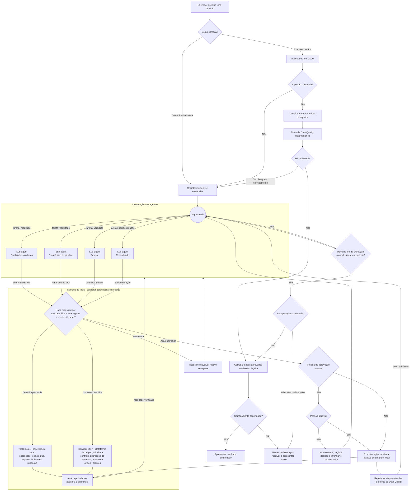
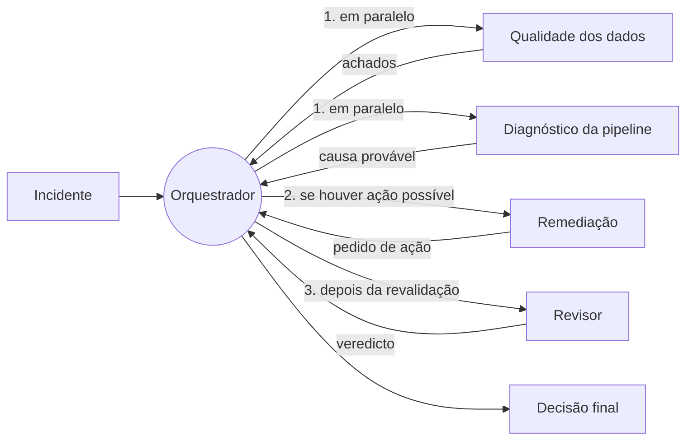
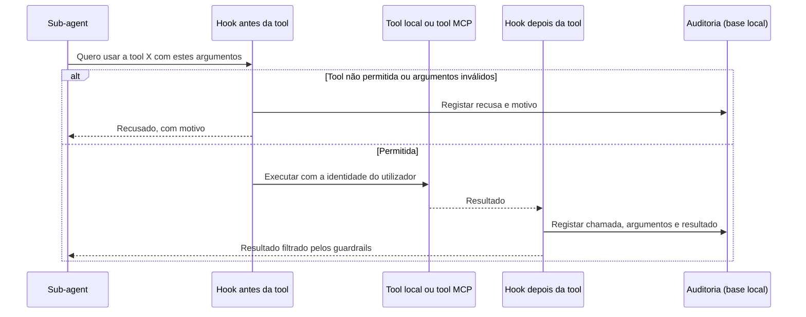

# Como vai funcionar o projeto

Este guia explica a ideia de forma simples. A maior parte do fluxo descrito
abaixo **ainda será desenvolvida**. Para acompanhar o estado real do projeto,
consulta o [registo de progresso](progresso.md).

## 1. Qual é a ideia?

Imagina uma empresa que recebe diariamente uma lista de encomendas. Antes de
usar esses dados em relatórios, é importante verificar se estão corretos:

- Todas as encomendas têm cliente?
- Há encomendas repetidas?
- Os valores estão dentro dos limites esperados?
- Os dados chegaram a tempo?

O projeto simula uma **pipeline de ingestão**, com dados fictícios: recebe um
lote JSON, transforma os registos, verifica a qualidade e carrega os dados
aprovados em SQLite. Quando surgir um problema, os futuros agentes vão
intervir **a meio da pipeline**, antes do carregamento, para investigar e
solicitar ações. A pipeline não avança só porque um agente diz que está tudo bem.

## 2. Esquema geral

O seguinte esquema mostra o **funcionamento pretendido**, não o que já está
todo implementado:

Os agentes **nunca acedem diretamente** aos dados, às bases SQLite ou ao
simulador: tudo passa por tools. E todas as chamadas de tools passam por
**hooks**, que são verificações em código executadas sempre, seja qual for a
decisão do modelo.

Há **três bases de dados com papéis diferentes**:

| | Destino | Base de controlo | Plataforma da origem (via MCP) |
|---|---|---|---|
| O que é | O "data warehouse" que recebe os dados | O que a nossa pipeline regista sobre si própria | Um sistema da equipa que envia as encomendas |
| Controlo | Só a etapa de carregamento escreve, e só dados aprovados | Nosso: lemos e escrevemos | Não é nosso: já tem dados e só a consultamos |
| Exemplos | Encomendas aprovadas | Execuções, logs, regras falhadas, incidentes, auditoria | Contrato do dataset, alterações de esquema anunciadas, estado da origem, incidentes da origem, cadastro de clientes |

O orquestrador **não segue uma ordem fixa**. Funciona como um coordenador:
recebe o incidente, decide que sub-agents chamar, recebe os resultados e decide
o passo seguinte. Pode chamar vários sub-agents em paralelo, voltar a chamar um
deles com mais contexto ou terminar quando não houver ações possíveis.

Os números indicam um percurso típico, não uma sequência obrigatória. Os
sub-agents **só falam com o orquestrador**: não se chamam uns aos outros.

### O que acontece numa chamada de tool

| Hook | Quando corre | O que verifica |
|---|---|---|
| Antes da tool | Antes de cada chamada | A tool está na lista deste agente? Se for MCP, a sua descrição é a que foi revista? O utilizador tem permissão? A ação exige aprovação? Os argumentos são válidos? |
| Depois da tool | Depois de cada chamada | Regista a chamada para auditoria e passa o resultado pelos guardrails (por exemplo, dados pessoais ou instruções escondidas no texto vindo da plataforma da origem). |
| Fim da execução | Antes da resposta final | A conclusão tem evidência de tools? Uma recuperação só é aceite se a revalidação a confirmar. |

Cada sub-agent só tem acesso às tools de que precisa, locais e MCP. **As tools
de consulta já existem**; as de ação ainda não.

| Sub-agent | Tools locais (o que aconteceu na pipeline) | Tools MCP (o que diz a origem) | Estado |
|---|---|---|---|
| Qualidade dos dados | Regras, resultados das regras, registos afetados, métricas do lote e runbook. | Contrato do dataset, alterações de esquema e cadastro de clientes. | Disponível |
| Diagnóstico da pipeline | Resumo e logs da execução, execuções recentes, comparação com o último sucesso, incidente e runbook. | Contrato, alterações de esquema, estado da origem e incidentes da origem. | Disponível |
| Remediação | Incidente e runbook; mais tarde, pedir ações como repetir a leitura ou reprocessar um lote. | Estado da origem e incidentes da origem. | Consultas disponíveis; ações por fazer |
| Revisor | Resultados das regras, resumo da execução e estado do destino. | Contrato do dataset. | Disponível |
| Orquestrador | Nenhuma tool de dados; recebe um resumo curto do incidente e delega. | — | Resumo disponível |

Uma falha na pipeline ou numa ferramenta também deve ser apresentada como tal.
Se o sistema não conseguir confirmar o resultado, não deve dizer que o problema
ficou resolvido.

## 3. O que vai acontecer, passo a passo?

### Passo 1 — Escolher uma situação

A pessoa pode fornecer um ficheiro JSON local e escolher um cenário, ou usar
os dados fictícios já incluídos. Exemplos de cenários:

- execução normal;
- encomendas duplicadas;
- dados em falta;
- serviço de origem indisponível.

Também está previsto iniciar a investigação a partir de um incidente já
detetado, sem executar uma nova pipeline.

### Passo 2 — Executar e verificar os dados

O simulador lê os dados, faz uma transformação simples (normalizar o texto
de `status`) e entrega o lote a um bloco separado de regras determinísticas.
Esse bloco não usa IA: verifica os dados com critérios explícitos.

Se todas as regras passarem, os dados são carregados em SQLite e relidos para
confirmar o carregamento. Se houver problemas, os dados **não chegam ao destino**:
a pipeline fica bloqueada no ponto onde os agentes irão intervir.

Se a origem estiver indisponível, a execução falha e as verificações de
qualidade ficam marcadas como não executadas, em vez de aparecerem como
aprovadas.

### Passo 3 — Guardar e investigar o incidente

Cada execução fica guardada em SQLite: etapas, logs, lote recebido e
transformado, resultado de cada regra e o incidente. É este contexto que os
agentes vão consultar através das tools, mesmo noutro processo. O
**orquestrador** — o agente que
coordena o trabalho — vai gerir uma equipa de **sub-agents** especialistas:

| Sub-agent | O que deverá fazer |
|---|---|
| Qualidade dos dados | Analisar regras, registos e métricas para perceber o que está incorreto. |
| Diagnóstico da pipeline | Consultar estado, logs e dependências para investigar uma causa provável. |
| Remediação | Solicitar uma ação simulada permitida, quando houver informação suficiente. |
| Revisor | Verificar o estado depois da ação e confirmar se o problema ficou resolvido. |

Como o orquestrador gere estes sub-agents:

1. **Decide quem chamar.** Uma origem indisponível pode precisar só do
   diagnóstico; registos duplicados precisam da análise de qualidade.
2. **Delega tarefas concretas.** Cada sub-agent recebe apenas a tarefa, a
   evidência necessária e as ferramentas que pode usar.
3. **Trabalha em paralelo quando faz sentido.** Qualidade e diagnóstico podem
   investigar ao mesmo tempo.
4. **Junta e avalia os resultados.** Se faltar evidência ou houver conclusões
   contraditórias, volta a delegar com perguntas mais precisas.
5. **Decide o passo seguinte.** Pede uma ação à remediação, pede confirmação
   ao revisor, ou termina com o problema por resolver.

O orquestrador não executa ações nem altera dados diretamente. Os sub-agents de
investigação só consultam informação. Mesmo quando o orquestrador decide
avançar, as permissões, as aprovações e o bloco de Data Quality continuam a ser
verificados em código.

### Passo 4 — Usar tools, MCP e hooks

Os sub-agents usam **tools** para obter informação, como consultar resultados
da pipeline ou ler um runbook. Um **runbook** é um procedimento documentado que
sugere como investigar ou tratar um problema.

- **Tools locais:** funções do projeto que só leem a base local e devolvem
  pouca informação de cada vez (regras, registos afetados, métricas, logs,
  estado das etapas), com referências para a evidência usada.
- **Runbooks:** ficheiros versionados com sinais, investigação, causas e
  remediações possíveis, associados a cada tipo de regra.
- **Servidor MCP:** representa a plataforma da equipa que envia os dados, um
  sistema que não controlamos e que já tem dados próprios num SQLite só de
  leitura. Responde a perguntas como "qual é o contrato deste dataset?",
  "houve alguma alteração de esquema anunciada?", "a origem está com
  problemas?" ou "este cliente existe?".
- **Hooks:** verificações em código que correm antes e depois de cada tool e
  no fim de cada execução (ver a tabela na secção 2). As tools só fazem o seu
  trabalho; os controlos estão todos nos hooks, tal como na sessão 05 do curso.

O servidor MCP não conhece os nossos agentes; somos nós que decidimos quem usa
cada tool. Como a descrição de uma tool MCP pode mudar sem aviso, cada uma é
revista e fixada por hash (sessão 03 do curso); se mudar, fica bloqueada. Uma
tool MCP passa pelos mesmos hooks que uma tool local, e todas as chamadas,
incluindo as bloqueadas, ficam registadas na base local. **Já existem** as
tools de consulta, os runbooks, o servidor MCP e os hooks antes e depois da
tool. Os agentes já validam os outputs e recusam referências não observadas
nas tools; uma resolução exige qualidade e entrega verificadas.

### Passo 5 — Decidir se é possível agir

O sub-agent de remediação pode pedir uma ação simulada. Antes de a executar, o
hook antes da tool:

1. Verifica se o utilizador tem permissão para a ação.
2. Se a ação exigir aprovação, apresenta o pedido a uma pessoa.
3. Só executa se as permissões e, quando necessária, a aprovação forem válidas.

Uma aprovação não substitui a permissão necessária. Se a ação for recusada ou
rejeitada, o motivo e a decisão deverão ficar registados.

Por exemplo, um problema de ingestão poderá exigir **repetir a leitura da
origem quando esta recuperar** ou **reprocessar um lote depois de corrigido**.
Isolar registos inválidos também poderá ser uma opção, mas só com uma política
explícita: eliminar registos não equivale automaticamente a resolver o problema.
Estas ações ainda serão implementadas; os agentes não vão inventar dados em
falta nem ignorar as regras para fazer o lote passar.

### Passo 6 — Confirmar o resultado

Depois da ação, as etapas afetadas serão repetidas e o mesmo bloco de Data
Quality terá de passar novamente. O revisor deverá consultar essa evidência;
só então a pipeline poderá carregar os dados e apresentar a recuperação.

Se a ação falhar, se os dados continuarem incorretos ou se não for possível
confirmar o efeito, o problema permanecerá por resolver.

### Passo 7 — Mostrar e guardar o histórico

A interface Streamlit serve para iniciar o processo, escolher o cenário e ver
logs e métricas. Mostra a execução como um workflow do GitHub Actions: as
etapas em fila, a etapa em curso a amarelo e as concluídas, falhadas ou
ignoradas, cada uma com os seus logs. **Esta parte já existe.**

O histórico de execuções já é lido de SQLite. A intervenção apresenta também
os passos dos agentes e as tools usadas. As investigações e as tentativas de
correção do mesmo incidente ficam guardadas na base de controlo.

Se uma execução for interrompida, o sistema deverá conseguir retomá-la:
recuperar o estado, verificar novamente as permissões e confirmar se uma ação
já foi executada antes de tentar repeti-la.

## 4. Um exemplo completo

**Cenário futuro:** algumas encomendas aparecem duplicadas.

1. A pessoa fornece ou seleciona um lote e inicia a pipeline simulada.
2. Uma regra identifica que existem identificadores de encomenda repetidos.
3. A pipeline bloqueia o carregamento e emite um incidente com a regra e os
   registos afetados.
4. O orquestrador delega, em paralelo, a análise dos dados ao sub-agent de
   qualidade e a análise da execução ao sub-agent de diagnóstico.
5. Os sub-agents consultam evidências e runbooks e devolvem os resultados ao
   orquestrador, que os junta e decide se há uma ação possível.
6. Se houver, o orquestrador delega ao sub-agent de remediação a preparação de
   um pedido de ação. A ação concreta e a necessidade de aprovação serão
   definidas durante o desenvolvimento.
7. O sistema verifica a permissão e pede aprovação humana, se for necessária.
8. Se a ação for autorizada, executa-a e volta a processar e verificar o lote.
9. O orquestrador pede ao sub-agent revisor que avalie a nova evidência. Se
   os dados passarem as regras e o carregamento for confirmado, o incidente
   fica resolvido; caso contrário, o orquestrador pode tentar outra abordagem
   ou manter o carregamento bloqueado e explicar o que continua por resolver.

A investigação e a submissão manual de um lote corrigido já existem. Cada
correção cria outra tentativa do mesmo incidente e repete o gate com as
regras originais, sem repetir as falhas sintéticas. Ações autónomas e
aprovações ainda não estão implementadas.

## 5. Como será desenvolvido?

| Fase | O que vamos construir | Estado |
|---|---|---|
| 1. Fundação e simulador | Projeto UV, ingestão JSON, transformação, bloco de qualidade e carregamento SQLite. | **Implementação inicial disponível**, com ponto de intervenção pendente. |
| 2. Persistência e avaliação | Guardar execuções, incidentes e contexto bloqueado; criar casos de avaliação reproduzíveis. | **Persistência disponível**; casos de avaliação por fazer. |
| 3. Ferramentas e runbooks | Disponibilizar consultas, procedimentos e ações simuladas verificáveis. | **Consultas e runbooks disponíveis**; ações por fazer. |
| 4. Agentes | Criar o orquestrador e os sub-agents especialistas com PydanticAI. | **Disponíveis**, com tools filtradas, outputs tipados e verificação de evidências. |
| 5. Segurança e retoma | Aplicar permissões, aprovações, registo de decisões e recuperação após interrupções. | Allowlist por agente, limite de chamadas e auditoria disponíveis; aprovações e retoma por fazer. |
| 6. MCP e memória | Integrar ferramentas MCP locais e memória com origem e validade. | **Servidor MCP da plataforma da origem disponível**; memória por fazer. |
| 7. Interface e avaliação completa | Interface Streamlit para iniciar, escolher cenários e ver logs e métricas; testar o fluxo de ponta a ponta. | **Interface e correções manuais disponíveis**; avaliação dos modelos por fazer. |

As fases serão validadas com testes à medida que forem construídas. A descrição
mais técnica está na [proposta de arquitetura](proposta-arquitetura.md).

## 6. O que já posso experimentar?

Hoje é possível executar a pipeline pela linha de comandos ou pela interface
Streamlit, receber um JSON local (no CLI) e acompanhar as etapas e os logs. Os
lotes aprovados são efetivamente guardados em SQLite. Os lotes com problemas
ficam bloqueados, e todo o seu contexto fica na base local. As tools locais e
o servidor MCP da plataforma da origem já deixam consultar esse contexto e os
dados externos.

As instruções de instalação, execução e teste estão no [README](README.md).
Já existem os agentes, a investigação de incidentes e a submissão de
correções no frontend, com ficheiro ou texto JSON. Ainda não existem ações
autónomas, aprovações ou retoma após interrupção. A etapa de revalidação após
uma ação autónoma continua reservada; a correção manual repete o gate numa
nova tentativa.

O projeto usa dados fictícios. Os agentes usam a configuração OpenAI do curso
e estão desligados por omissão: ativá-los implica enviar ao fornecedor
remoto o contexto e as consultas selecionadas pelas tools.
