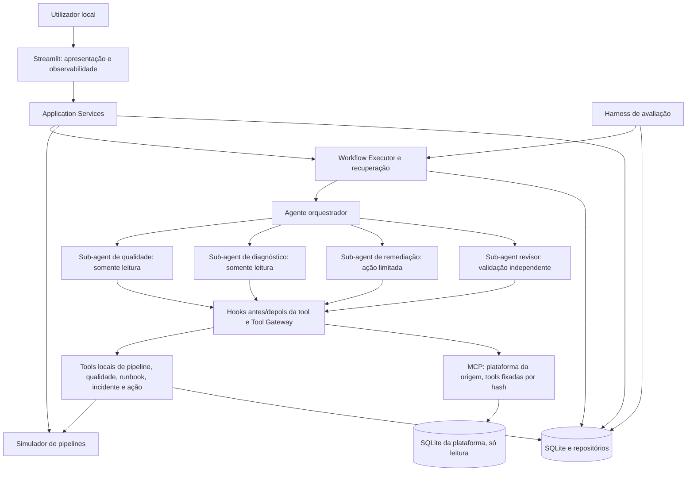
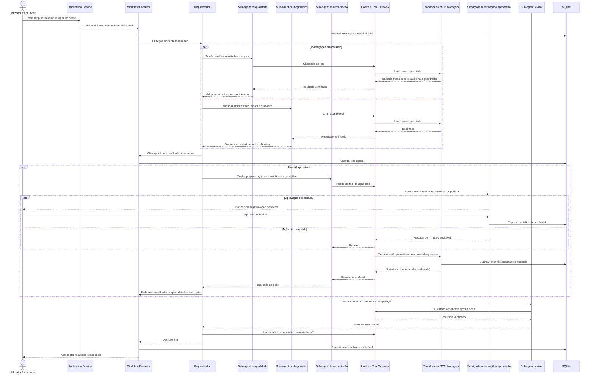

# Proposta de projeto e arquitetura

## Sistema local de Data Quality baseado em agentes

**Estado:** proposta arquitetural; desenvolvimento faseado iniciado pelo simulador
**Contexto:** projeto académico do `course-02-agentic-ai`
**Execução prevista:** local, com dados sintéticos e serviços simulados

## 1. Resumo

Propõe-se um sistema local que deteta e investiga problemas de qualidade de
dados em pipelines simulados. Um workflow persistente coordena agentes
especializados, consulta ferramentas e runbooks, solicita aprovação para ações
sensíveis e verifica os efeitos antes de encerrar um incidente.

O modelo não é a autoridade sobre permissões nem sobre o estado do sistema:
essas decisões são aplicadas por serviços determinísticos. Os agentes
interpretam evidência e recomendam ou solicitam ações; ferramentas controladas
leem o estado real do simulador e executam as operações permitidas.

O projeto ficará inicialmente em `projects/agentic-data-quality/`, mas terá a
sua própria configuração, código, testes e documentação. Não deverá depender
do pacote principal deste repositório, para que possa ser movido mais tarde
para um repositório independente.

## 2. Problema e oportunidade

Problemas de qualidade de dados — como valores nulos, duplicados, violações de
regras, alterações de schema, atrasos e anomalias de volume — são muitas vezes
detetados depois de afetarem relatórios ou processos a jusante. A investigação
pode exigir cruzar métricas, resultados de validação, logs, alterações recentes
e procedimentos operacionais.

As abordagens baseadas apenas em regras detetam condições conhecidas, mas não
coordenam por si só a investigação de causas ambíguas, a seleção de evidência
ou a comunicação entre equipas. Um agente pode ajudar a resumir e relacionar
essa evidência e a escolher o próximo passo. Porém, uma conversa entre agentes
não é suficiente: ações e conclusões têm de ser limitadas por contratos,
permissões, persistência e verificações em código.

O projeto demonstra essa combinação num ambiente reproduzível, sem acesso a
dados ou infraestrutura de produção.

## 3. Utilizadores e necessidades

| Utilizador | Necessidades principais |
|---|---|
| Data Engineer | Identificar pipelines afetados, causa provável e dependências; recuperar a execução com segurança. |
| Data Quality Engineer | Consultar regras, amostras e métricas; distinguir falha real de falso positivo; acompanhar tendências. |
| Operações de dados / on-call | Priorizar incidentes, consultar runbooks, aprovar ações e confirmar a recuperação. |
| Docente ou avaliador | Reproduzir cenários, inspecionar decisões e ferramentas usadas e comparar resultados com critérios explícitos. |

## 4. Objetivos e limites

### Objetivos da primeira versão

- Criar e executar pipelines simulados com dados sintéticos e cenários
  determinísticos.
- Detetar nulos, duplicados, violações de regras, valores fora dos limites,
  problemas referenciais, alterações de schema, falhas, atrasos e anomalias
  de volume.
- Persistir pipelines, execuções, incidentes, evidência, ações, aprovações,
  eventos de auditoria e memória localmente em SQLite.
- Coordenar um orquestrador e agentes especialistas com responsabilidades
  distintas e contratos Pydantic.
- Expor ferramentas locais selecionadas, incluindo através de MCP, sem dar aos
  agentes acesso arbitrário à base de dados ou ao sistema operativo.
- Pedir aprovação para ações configuradas como sensíveis e confirmar o efeito
  observado antes de declarar um incidente resolvido.
- Retomar workflows interrompidos sem repetir ações já concluídas.
- Disponibilizar uma interface Streamlit de observabilidade, sem lógica de
  negócio nela.
- Executar testes e avaliações sem exigir chamadas a um modelo.

### Limites da primeira versão

- Não liga a pipelines, clouds, bases de dados ou sistemas de tickets reais.
- Não altera dados de negócio reais nem executa comandos arbitrários.
- Não é um serviço multiutilizador ou remoto; UI, SQLite e servidores MCP são
  locais.
- Não inclui aprendizagem automática para deteção estatística avançada; começa
  com regras e métricas sintéticas avaliáveis.
- Não inclui memória vetorial: a memória inicial é estruturada e filtrada em
  SQLite.
- Um fornecedor de modelos pode ser configurado para as execuções dos agentes.
  Essa chamada pode sair da máquina se for usado um serviço remoto; chaves ficam
  em `.env`, e o modo de avaliação deve suportar modelos falsos locais. Um modo
  totalmente offline poderá ser acrescentado se vier a ser requisito.

## 5. Papel do Meridian

O Meridian existente é um simulador de uma bolsa fictícia: modela componentes,
incidentes, métricas, logs, ferramentas, ações, aprovações e avaliação. Não é,
por si só, um simulador de pipelines de dados nem de regras de Data Quality.

Assim, a proposta usa o Meridian como **referência prática e pedagógica** para:

- cenários com seed, falhas reproduzíveis e evidência observável;
- ferramentas rastreáveis e ações com idempotência;
- execução e validação por critérios explícitos;
- integração MCP com catálogo e controlo de permissões;
- memória com origem, validade, correções e isolamento;
- avaliação do resultado e da trajetória do agente.

O projeto implementará um simulador próprio de pipelines e datasets sintéticos,
com abstrações inspiradas nesses padrões. O domínio central não importará
`meridian` nem dependerá dos seus modelos de bolsa. Uma interface de simulador
permitirá trocar a implementação local mais tarde sem alterar os agentes ou os
serviços de workflow.

### Fluxo de ingestão e intervenção

O simulador deve representar uma pipeline, não apenas produzir métricas:
**entrada JSON → transformação → bloco de Data Quality determinístico →
carregamento SQLite**. No exemplo inicial, a transformação normaliza o texto
de `status` e o carregamento é confirmado por leitura no destino.

Se a qualidade falhar, o carregamento é bloqueado e o ponto de intervenção dos
agentes fica pendente. Na integração futura, os agentes poderão investigar o
incidente e solicitar ações permitidas de recuperação da ingestão ou
reprocessamento. Depois de uma ação, as etapas afetadas e o mesmo bloco
determinístico terão de ser executados novamente antes de carregar os dados.
Um parecer do modelo não substitui esse controlo.

Nesta fase estão implementados a ingestão, transformação, gate e destino, a
persistência de cada execução e do seu incidente, as tools de consulta locais,
o servidor MCP da plataforma da origem e a equipa PydanticAI com orquestrador
e quatro especialistas. A interface aceita um lote corrigido para o mesmo
incidente, numa nova tentativa com as regras originais. Ações autónomas,
aprovações e retoma após interrupção continuam previstas para fases seguintes.
Não há reparação automática fictícia.

## 6. Arquitetura proposta



### Camadas e responsabilidades

| Camada | Responsabilidade |
|---|---|
| Apresentação | Streamlit permite iniciar execuções, escolher cenários e acompanhar logs e métricas. Não contém regras de negócio. |
| Application Services | Casos de uso para executar pipelines, abrir/investigar incidentes, aprovar ações e retomar workflows. |
| Workflow Executor | Guarda checkpoints, transições, tentativas e eventos; valida entradas e saídas dos agentes; implementa recuperação. |
| Agentes | Interpretam pedidos e evidência e devolvem contratos estruturados. Não acedem diretamente a SQLite, ficheiros ou simulador. |
| Tool Gateway e hooks | Hooks antes de cada tool (catálogo allowlist, identidade, escopos, autorização e aprovação), depois de cada tool (auditoria e guardrails) e no fim da execução (exigência de evidência). Aplicam-se igualmente a tools Python e MCP. |
| Tools e serviços de domínio | Implementam consultas, regras de Data Quality, runbooks e ações; devolvem resultados tipados e rastreáveis. |
| Simulador | Produz dados sintéticos, execuções, falhas, métricas e efeitos observáveis de ações. |
| Persistência | SQLite, acessível através de repositórios; transações para estado de workflow, auditoria, aprovação e ação. |
| MCP | Servidor da plataforma da origem: sistema externo só de leitura, com a sua própria base de dados. As tools MCP são fixadas por hash e passam pelo mesmo gateway e pelas mesmas políticas das tools locais. |
| Harness de avaliação | Executa casos determinísticos, recolhe trajetórias e compara efeitos e resultados com expectativas. |

### Organização de código pretendida

Esta é uma estrutura-alvo. Já existem `simulator/`, `persistence/`, `tools/`,
`mcp/`, `runbooks/` (dentro do pacote, para ser distribuído com ele), `ui/`,
`service.py` e `context.py`:

```text
projects/agentic-data-quality/
├── README.md
├── proposta-arquitetura.md
├── pyproject.toml
├── uv.lock
├── .env.example
├── src/data_quality_agent/
│   ├── domain/             # entidades, contratos e políticas
│   ├── services/           # casos de uso e regras de negócio
│   ├── agents/             # orquestrador e especialistas PydanticAI
│   ├── tools/              # interfaces e ferramentas permitidas
│   ├── mcp/                # servidor MCP e dados da plataforma da origem (só leitura)
│   ├── simulator/          # pipelines, dados sintéticos e cenários
│   ├── persistence/        # SQLite, repositórios e migrações
│   ├── workflows/          # executor, estados e recuperação
│   └── ui/                 # páginas e componentes Streamlit
├── runbooks/
├── scenarios/
├── evaluations/
└── tests/
    ├── unit/
    ├── integration/
    └── e2e/
```

O pacote instalável será independente do pacote `gen-ai-course`; no momento de
mover o projeto, o seu diretório poderá tornar-se a raiz do novo repositório.

## 7. Agentes, contratos e limites

Todos os resultados usados por outro componente serão validados por modelos
Pydantic. Os contratos devem incluir identificadores de execução/incidente,
estado explícito, evidências com origem, incertezas, recomendações e
referências às ferramentas usadas. Texto livre não autoriza uma ação.

| Agente | Responsabilidade e limite |
|---|---|
| Orquestrador | Interpreta o pedido, identifica pipeline e incidente, delega trabalho, integra respostas e controla a progressão. Não executa SQL nem ações diretamente. |
| Investigador de Data Quality | Consulta perfil, regras e amostras sintéticas. Devolve achados tipados, registos de evidência, severidade e métricas. Não altera dados. |
| Diagnóstico de Pipeline | Consulta estados, logs, dependências, métricas e runbooks. Devolve causas prováveis e evidência. Não altera a execução. |
| Remediação | Transforma uma tarefa autorizada numa ação permitida. Não define permissões, não aprova a própria ação e não declara sucesso com base na sua resposta. |
| Revisor | Lê o estado após a ação e compara-o com critérios objetivos de recuperação. Só emite resolução quando os critérios forem confirmados. |

Investigação de qualidade e diagnóstico de pipeline podem decorrer em paralelo.
O orquestrador envia ao agente de remediação apenas a tarefa necessária, a
evidência relevante e as restrições de segurança.

## 8. Workflow principal



O orquestrador decide dinamicamente que sub-agents chamar, pode repetir uma
delegação com mais contexto e termina quando há recuperação confirmada ou não
restam ações possíveis. Os sub-agents só comunicam com o orquestrador. Os hooks
correm em código antes e depois de cada tool (Python ou MCP) e no fim da
execução, seja qual for a decisão do modelo.

O sistema também permite submeter um incidente já detetado, sem executar uma
nova pipeline. Respostas inválidas, ferramentas indisponíveis e verificações
inconclusivas produzem estados e erros explícitos; não se convertem em sucesso.

## 9. Estado, ações e recuperação

Estados propostos para um workflow:

`created → collecting → diagnosing → awaiting_approval → remediating → verifying → completed`

Estados terminais ou de interrupção adicionais: `rejected`, `failed`,
`paused`, `verification_failed`. Uma etapa só avança após guardar o respetivo
resultado validado. Aprovação não é autorização por si só: política de
permissões e aprovação aplicam-se separadamente, antes da execução.

Na retoma, o executor deverá:

1. carregar o workflow, o contexto, os resultados e o último checkpoint;
2. confirmar a identidade e recalcular as permissões com a política atual;
3. consultar registos de ações e o estado observado antes de decidir repetir;
4. reutilizar a mesma chave idempotente para uma intenção igual e recusar
   reutilização conflituosa;
5. confirmar uma ação de resultado desconhecido junto do executor/simulador;
6. continuar da próxima etapa incompleta e gravar o novo evento.

Uma chave não deve depender apenas de texto arbitrário do modelo. Deve ser
derivada em código da identidade do workflow, intenção validada, alvo e
versão/revisão da tarefa. Repetir a verificação é seguro; repetir um efeito não
verificado não é.

## 10. Ferramentas, MCP e segurança

- Cada ferramenta terá nome, descrição, esquema de argumentos, contrato de
  retorno e escopo necessários.
- A lista exposta será allowlist, filtrada por agente e caso de uso. MCP não
  alarga as permissões existentes.
- Ferramentas de leitura e de escrita serão separadas. Investigadores recebem
  apenas leitura; o agente de remediação recebe ações explicitamente
  autorizáveis.
- Nenhum agente executará SQL arbitrário. As operações de SQLite serão
  consultas/repositórios tipados e parametrizados.
- A política de autorização é código determinístico e recebe identidade,
  papel, ação, alvo, criticidade e aprovação correspondente. O agente não pode
  aprovar a si próprio.
- Aprovações são específicas a ação e alvo, expiram ou são invalidadas segundo
  política explícita e ficam auditadas com autor, decisão e instante.
- Runbooks são procedimentos nossos, versionados e revistos: orientam a
  análise, mas não substituem verificação nem política. O texto livre vindo
  da plataforma da origem é conteúdo não confiável. Ações extraídas de um runbook continuam sujeitas a
  autorização.
- Dados e logs apresentados ao modelo serão mínimos e filtrados. O MVP usa
  dados sintéticos; segredos nunca são gravados em logs, base de dados ou
  exemplos versionados.
- O servidor MCP corre localmente, preferencialmente por transporte stdio. Não
  haverá endpoint remoto na primeira versão. A UI, o MCP e SQLite partilham a
  mesma política de acesso.

**Implementado:** duas origens de tools com duas bases de dados separadas.

- **Tools locais** (`tools/data_tools.py`), no mesmo processo, sobre a base
  local: execuções, logs, regras, registos, incidentes e runbooks.
- **Servidor MCP `orders-platform`** (`data-quality-mcp`, FastMCP, stdio):
  representa a plataforma da equipa que produz os dados, um sistema que não
  controlamos. Tem o seu próprio SQLite já preenchido
  (`mcp/data/orders_platform.sqlite3`, gerado de `platform.sql`), aberto em
  `mode=ro`, com contrato do dataset, alterações de esquema, estado da origem,
  incidentes da origem e cadastro de clientes. Não conhece os nossos agentes e
  anuncia todas as suas tools.

O catálogo (`tools/catalog.py`) é nosso: indica a origem de cada tool e que
agente a pode usar. O cliente MCP (`tools/platform_client.py`) fixa cada tool
pelo hash do nome, descrição e esquema de parâmetros (`tools/mcp_lock.json`,
sessão 03); uma tool nova ou alterada fica bloqueada até ser revista com
`data-quality-mcp-lock --update-lock`. Tools locais e MCP passam pelo mesmo
`ToolGateway`, com hooks antes (allowlist, limite de chamadas e tool fixada) e
depois (limite de tamanho e marca de conteúdo não confiável para o texto
livre da origem: alterações de esquema e incidentes da origem), e todas ficam
auditadas em `tool_calls` da base local, com a origem. As tools são só de
leitura, e as locais nunca revelam o cenário nem os logs que só descrevem a
simulação. Os agentes validam as referências dos seus outputs contra as
tools efetivamente usadas; a resolução exige revisão independente e
confirmação determinística. Ficam por fazer: ações (serão tools locais,
porque a plataforma é só de consulta), autorização e aprovações.

## 11. Persistência e memória

SQLite é a fonte de verdade local. Acesso feito por repositórios e transações;
versão de schema mantida por migrações explícitas. Tabelas iniciais propostas:

| Tabela | Conteúdo essencial |
|---|---|
| `pipelines`, `pipeline_runs` | Definição sintética, versão, estado e tempos das execuções. |
| `incidents` | Identidade, pipeline, severidade, estado e relação com a execução que originou o incidente. |
| `quality_findings` | Regra, alvo, contagens, severidade, evidência e origem. |
| `workflow_runs`, `workflow_steps` | Estado, contexto referenciado, tentativas, checkpoints e outputs validados. |
| `actions`, `approvals` | Intenção, chave idempotente, executor, efeito, decisão e referências de aprovação. |
| `audit_events` | Sequência imutável de decisões e chamadas de ferramentas sem incluir segredos. |
| `memories` | Conteúdo, tipo, assunto, origem, referência, autor, escopo, confiança, validade e correção/substituição. |

Memórias são factos auxiliares, não substituem o estado atual do pipeline. Cada
registo tem proveniência, validade, escopo (por exemplo, equipa e pipeline),
confiança e estado. Registos expirados, corrigidos ou de outro escopo não são
apresentados como factos atuais. Escrita, correção, esquecimento e proposta de
runbook seguem políticas explícitas; procedimento operacional só é publicado
após revisão humana.

**Implementado (migrações 1 a 4), na base de controlo:** `pipelines` (versionada por hash da definição),
`pipeline_runs` (com o caminho do destino de cada execução), `run_stages`,
`run_events` (gravados ao vivo, modo WAL), `run_records`, `quality_findings`,
`incidents` e `tool_calls` (auditoria das tools, com a origem `local` ou
`mcp`, acrescentada na migração 2). A migração 4 acrescenta
`incident_workflows` e `incident_attempts` (identidade estável e correções),
e `agent_sessions` e `agent_steps` (outputs, falhas e passos dos agentes).
Checkpoints para retoma, ações, aprovações e memórias serão acrescentados em
novas migrações. Os runbooks são ficheiros versionados, não linhas da
base de dados. Há mais dois ficheiros fora destas migrações: o destino
(`runs/warehouse.sqlite3`, tabela `pipeline_output` com os dados aprovados,
retirada da base de controlo na migração 3) e a plataforma da origem, só de
leitura (ver secção 10).

## 12. Interface Streamlit

Âmbito decidido: a interface serve apenas para **iniciar o processo, escolher
cenários e ver logs e métricas**. Apresenta cada execução ao estilo de um
workflow do GitHub Actions: um grafo com as etapas, a etapa em curso destacada
em tempo real e um bloco de logs expansível por etapa.

Implementado (módulo `src/data_quality_agent/ui/`):

- seleção de cenário, destino SQLite e botão de execução;
- acompanhamento ao vivo através dos eventos publicados pelo motor
  (`stage_started`, `stage_finished` e `log`);
- histórico das execuções lido de SQLite, métricas do lote, regras falhadas,
  incidente e dados recebidos, transformados e carregados.

Previsto, quando existirem: passos e logs dos agentes e das tools dentro da
etapa de intervenção.
Como a interface não inclui aprovações, o canal para a aprovação humana fica em
aberto.

A camada visual invoca serviços de aplicação e apresenta estados; não contém
autorização, coordenação de agentes ou regras de Data Quality.

## 13. Correspondência com o curso

| Sessão / conceito | Aplicação no projeto |
|---|---|
| 01 — Agent Harness e PydanticAI | Contratos de saída, ferramentas concretas e verificador que impede resolução sem evidência de recuperação. |
| 02 — Context, Tools, Skills | Seleção de contexto relevante, catálogo de ferramentas limitado, runbooks como procedimentos e ações idempotentes. |
| 03 — Integração MCP | Servidor MCP externo só de leitura, catálogo aprovado, fixação por hash, scopes, controlo de chamadas e correlação de fontes de incidente. |
| 04 — Memória | Política de escrita e recall, origem, confiança, validade, conflitos, correção, esquecimento e isolamento por equipa/pipeline. |
| 05 — Segurança | Autorização em código, identidade do utilizador, menor privilégio, aprovação humana e evidência para resistir a instruções maliciosas nos dados. |
| 06 — Avaliação | Casos acumulados e reservados, comparação entre versões, verificação de trajetória, critérios de adoção e prevenção de regressões. |
| 07 — Multi-agent | Orquestrador que delega a investigadores read-only e a remediação controlada, com integração e revisão independente. |
| Meridian — simulador e harness | Padrões de cenários com falhas reproduzíveis, rastreio de tools, executor, efeitos verificáveis e avaliação local; o domínio de Data Quality será implementado separadamente. |

## 14. Critérios de avaliação e aceitação

Cada cenário terá dados, falha injetada, expectativa e critérios de verificação
versionados. A avaliação irá observar tanto o resultado como a trajetória:

- **Deteção:** cada cenário deteta os tipos de falha declarados; cenários
  saudáveis não geram incidentes indevidos.
- **Diagnóstico:** causa e evidências citadas correspondem ao cenário, sem
  tratar memória ou texto de logs como estado autoritativo.
- **Contrato:** respostas inválidas de qualquer agente são rejeitadas e
  registadas; não fazem avançar a etapa.
- **Falha de ferramenta/modelo:** indisponibilidade, timeout ou falta de
  contexto deixa estado explícito e permite retoma controlada.
- **Permissões:** leituras e escritas respeitam o papel; ação sensível sem
  aprovação válida é recusada; aprovação não concede permissões adicionais.
- **Idempotência:** resposta perdida e repetição da mesma intenção não aplicam
  o efeito duas vezes; alvo ou payload diferente com chave reutilizada é
  recusado.
- **Verificação:** o workflow não termina como resolvido até a leitura do
  estado confirmar os critérios configurados.
- **Retoma:** workflow interrompido recupera contexto e estado, revê permissões
  e continua sem repetir ação concluída.
- **Memória:** registos inválidos por escopo ou validade não influenciam o
  diagnóstico; correções preservam proveniência e histórico auditável.
- **MCP:** somente ferramentas permitidas são visíveis e executáveis; chamadas
  recusadas ficam registadas.
- **Observabilidade:** UI e histórico refletem estado persistido, aprovações,
  falhas, ações e resultados verificados.
- **Reprodutibilidade:** a suite determinística executa sem chave de API; testes
  de modelo podem ser opcionais e separados.

### Cenários mínimos

1. Pipeline saudável sem falso incidente.
2. Nulos e duplicados em campos críticos.
3. Violação de regra de negócio e valores fora do intervalo.
4. Quebra de schema ou integridade referencial.
5. Atraso e anomalia de volume.
6. Causa no pipeline ou dependência indisponível, com evidência em sinais e
   logs sintéticos.
7. Mitigação simulada permitida, com resultado confirmado.
8. Ação que exige aprovação: rejeição e aprovação em execuções distintas.
9. Timeout após efeito, com consulta do estado e retoma sem duplicação.
10. Texto da plataforma da origem contendo instrução indevida, sem contornar as políticas.
11. Memória expirada, conflitante ou de outra equipa.
12. Output inválido e ferramenta indisponível, sem conclusão falsa.

Os casos devem ter conjunto de desenvolvimento e conjunto reservado. Alterar
prompt, ferramentas ou modelo exige executar a suite e comparar taxa de
sucesso, violações de política, ações desnecessárias, falsos positivos e custo
quando aplicável.

## 15. Plano incremental

1. **Fundação e simulador:** criar projeto Python/UV independente, contratos de
   domínio, datasets sintéticos, cenários determinísticos e verificações de
   Data Quality sem agentes.
2. **Persistência e harness:** SQLite, repositórios, pipeline runs, incidentes,
   eventos, suite de avaliação e testes sem modelo.
3. **Tools e runbooks:** interfaces tipadas, catálogo limitado, leitura de
   dados persistidos e ações simuladas verificáveis/idempotentes.
4. **Agentes:** investigador, diagnosticador, remediador, revisor e
   orquestrador; testar contratos e coordenação com doubles locais.
5. **Segurança e recuperação:** autorização, aprovação, auditoria, checkpoints,
   falhas injetadas e retoma.
6. **MCP e memória:** servidor MCP da plataforma da origem integrado ao mesmo
   gateway, catálogo, fixação por hash e políticas de memória.
7. **Streamlit e avaliação ponta a ponta:** observabilidade, fluxo de
   aprovação, histórico, cenários completos e documentação de execução.

Cada fase deve terminar com testes determinísticos e manter executáveis os
cenários anteriores. O desenvolvimento começa pela criação do projeto UV
independente e pelo simulador sintético, mantendo esta proposta como referência
para validar as fases seguintes.

## 16. Decisões em aberto para a fase de implementação

- Fornecedor e modelo usados fora dos testes determinísticos; confirmar se
  “só local” também significa inferência sem qualquer chamada externa.
- Quais ações simuladas serão incluídas no MVP e quais exigirão aprovação
  obrigatória.
- Formato e limites das regras configuráveis pelos utilizadores.
- Política de retenção e exportação dos dados locais.
- Se a memória será apenas por equipa ou também por pipeline e ambiente.

Estas decisões não alteram a separação principal: modelo propõe, serviços
validam, autorização decide, executor age e verificador confirma.
